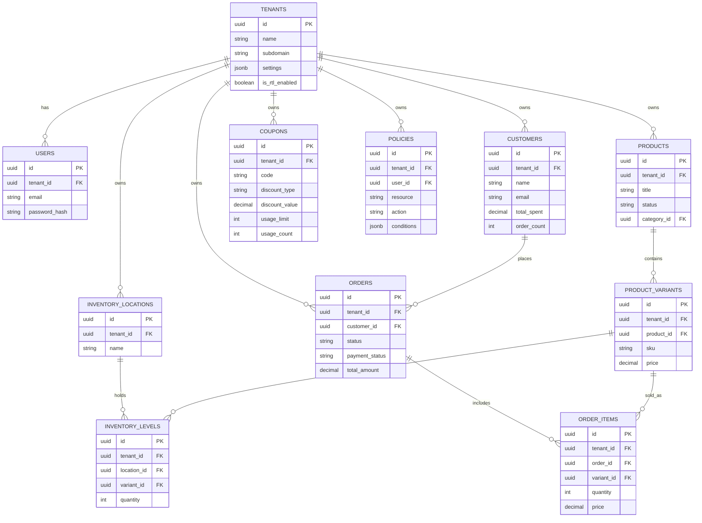

# Mini Commerce Backend Architecture & Task Plan

## Architectural Foundations (Sprint 0)
*   **Tenancy Model:** Row-Level Security (RLS) enforced at the database level. Every table (except system/global tables) includes a `tenant_id` column.
*   **Access Control:** Policy-Based Access Control (PBAC). Permissions are evaluated dynamically based on policies (e.g., resource attributes, user context, action) rather than static roles.
*   **API & Contracts:** Define OpenAPI/Swagger specs for all domains to enable immediate unblocked frontend development.

---

## Parallel Workstreams & Task Breakdown

### Track A: Auth, Store Profile & Tenant Management
*   **Task A1: Multi-Tenant Onboarding & RLS Configuration**
    *   Setup database RLS policies ensuring isolation via `tenant_id`.
    *   Store registration flow and subdomain allocation (`subdomain.mini.shop`).
*   **Task A2: Policy-Based Access Control (PBAC) Engine**
    *   Design policy schema and evaluation engine (e.g., subject, action, resource, conditions).
    *   User invite system linked to policies (e.g., "User X can only View Orders in Warehouse Y").
*   **Task A3: Store Configuration API**
    *   CRUD endpoints for store profile, branding (colors, logo), and localization (EN/AR, RTL toggle).
*   **Task A4: Media Upload Service**
    *   Secure Cloud Storage/S3 integration for static assets with tenant-scoped paths.

### Track B: Product Catalog & Taxonomy
*   **Task B1: Product Data Model & RLS**
    *   Implement `products`, `variants`, and `categories` tables with `tenant_id`.
    *   Support bilingual JSONB fields for titles and descriptions.
*   **Task B2: Catalog Management Endpoints**
    *   CRUD operations for products, variants, and category assignments.
*   **Task B3: Catalog Search & Filter**
    *   Full-text search, filtering by stock status, category, and price.

### Track C: Multi-Warehouse Inventory
*   **Task C1: Inventory Domain Model**
    *   Manage `inventory_locations` (warehouses) and `inventory_levels` mapping variants to locations.
*   **Task C2: Stock Adjustment & Audit API**
    *   Endpoints for stock adjustments with immutable `inventory_logs`.
*   **Task C3: Threshold Monitoring**
    *   Low-stock ("critical" vs "healthy") alert logic and summary endpoints.

### Track D: Orders & Checkout Lifecycle
*   **Task D1: Cart Session & Inventory Locking**
    *   Cart state persistence and temporary stock reservations.
*   **Task D2: Order State Machine**
    *   Manage order statuses and payment webhooks (Stripe, Paymob, etc.).
*   **Task D3: Fulfillment Workflow**
    *   Deduct stock from specific locations, handle shipping details, and generate timeline events.
*   **Task D4: Order Management API**
    *   Search, filter, and detail views for merchant dashboard.

### Track E: Promotions & Coupons
*   **Task E1: Coupon Rule Engine**
    *   Schema for dynamic rules (percentage, fixed, free shipping, limits, expiry).
*   **Task E2: Validation & Application Service**
    *   Checkout evaluation service to apply deductions safely.
*   **Task E3: Coupon Lifecycle Management**
    *   CRUD for active, scheduled, and expired coupons.
*   **Task E4: Coupon Attribution Tracker**
    *   Track total sales and orders driven by specific codes.

### Track F: Customer CRM
*   **Task F1: Customer Profiling**
    *   Maintain customer records, aggregated order counts, and lifetime value computations.
*   **Task F2: Dynamic Segmentation**
    *   Logic to auto-tag users (VIP, Repeat, New).
*   **Task F3: CRM Endpoints**
    *   Search and filter endpoints for customer tables.

### Track G: Analytics & Reporting
*   **Task G1: Event Aggregation Pipeline**
    *   Daily rollups for revenue, orders, and conversion metrics.
*   **Task G2: High-Level KPI Endpoints**
    *   Serve stats for top widgets (Revenue vs previous period, AOV, Conversion).
*   **Task G3: Trends & Channel Breakdowns**
    *   Time-series data for dashboard charts and channel attribution.

---

## Database Entity-Relationship Diagram (ERD)

